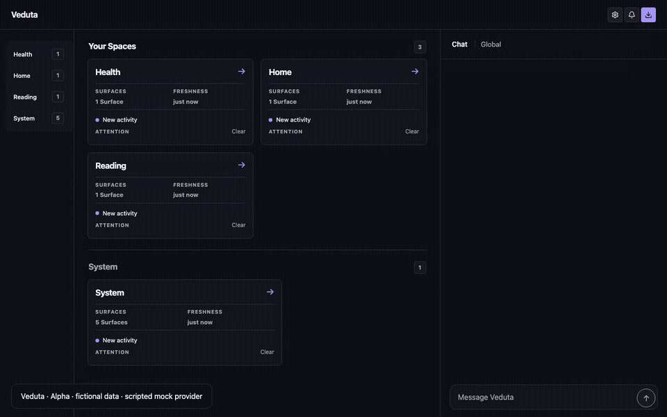
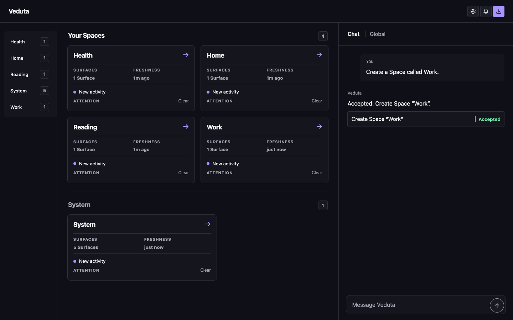
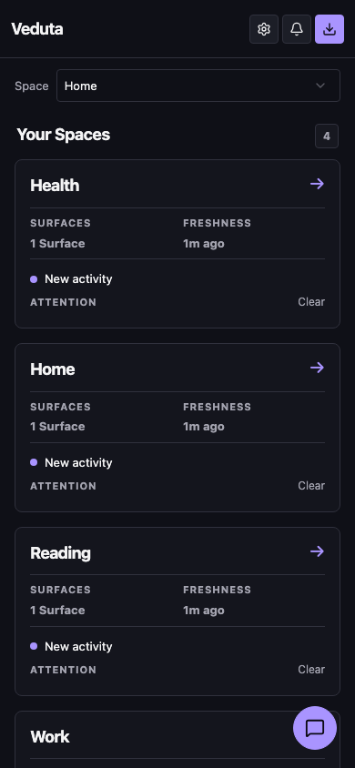
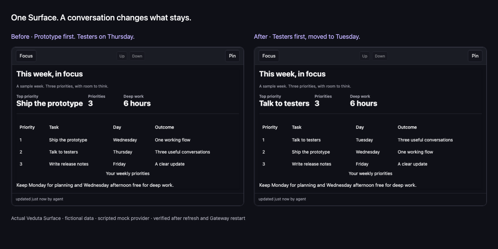

# Veduta — Give your personal AI agent a home.

An open-source personal AI Agent that turns conversations into **persistent, living interfaces**.
Open **Home** to see your life areas as **Spaces**. Talk to one Agent to create and update their
**Surfaces** for plans, trackers, lists and ongoing work; come back later and pick up where you left off.

[](docs/media/veduta-demo.mp4)

[Watch demo](docs/media/veduta-demo.mp4) · [Try the guided demo](#try-the-guided-demo) ·
[Try locally](#try-it-on-your-computer) · [Self-host](#install-on-a-vps)

- **Persistent visual Surfaces** — a conversation becomes something you can return to.
- **One Agent across your Spaces** — separate context for the parts of your life.
- **Proactive updates and Automations** — recurring work starts with your confirmation.
- **Self-hosted, open source, MIT** — your installation and your choice of Model connection.

**Early alpha.** You cover hosting and model costs. The video uses the real PWA and Gateway
with a **scripted mock provider and fictional data**. It demonstrates saved state, not real-model
quality. See [project status and costs](#project-status-and-costs) before connecting personal accounts.

## How it works

1. **Create a Space.** Ask for Work, Health or another life area, then confirm the proposal.
2. **Describe a Surface.** Ask the Agent for a useful plan, tracker or list in that Space.
3. **Change it through Chat.** A follow-up updates the same persistent Surface.
4. **Come back.** Refresh and reopen the Space: your Surfaces and Chat timeline remain.

The demo creates Work, prepares a Weekly plan, moves tester interviews to Tuesday and makes them
the top priority. The recording script verifies the edited result after both page refresh and
a Gateway restart. [Recording and transcript](docs/DEMO.md).

## Screenshots

<table>
  <tr>
    <th>Home on desktop</th>
    <th>Home on mobile</th>
  </tr>
  <tr>
    <td></td>
    <td></td>
  </tr>
</table>



Actual product captures with fictional data. The GIF is accelerated; the MP4 follows the full
journey at a readable pace, with captions.

## Use cases

| Space   | Start with a Surface                 | Keep it living through Chat                           |
| ------- | ------------------------------------ | ----------------------------------------------------- |
| Work    | A weekly plan with three priorities  | Move an interview and change the top priority         |
| Health  | A weight tracker or a movement plan  | Record a measurement or adjust the plan               |
| Home    | Groceries and a plan for the weekend | Add what you need and change the plan as life changes |
| Reading | A reading list with notes            | Keep the next book and your observations in view      |

These are examples of Surface compositions, not separate Agents or fixed domain apps.

## Try the guided demo

From a current source checkout, with the [development prerequisites](#development):

```sh
pnpm install --frozen-lockfile
pnpm demo
```

Open **http://localhost:5190** for the landing page or **http://localhost:5190/demo.html** for
the guided tour. No VPS, model key or daemon is needed. Use the three sample prompts, accept
Work, edit the plan, then refresh.

The tour uses the product's Home, Chat and Surface components with fixed responses. Its state
stays in **this browser's local storage**, isolated from other visitors. It has no authentication,
Model connections, integrations, shell execution or access to a personal Gateway. **Reset demo**
starts over; clearing browser storage also removes the tour's changes. To evaluate real inference
and server persistence, use the [Local VPS profile](#try-it-on-your-computer).

The [static publication guide](docs/DEMO.md#publish-the-landing-and-guided-demo) explains how to
host the landing and tour independently. A public URL is not configured in this repository yet.

## Project status and costs

- **Software:** MIT licensed, with no Veduta subscription fee.
- **Hosting:** you pay for and operate your VPS, backups and any optional domain. Local trials
  need no VPS; a public static tour can use static hosting without running a Gateway.
- **Models:** the mock provider costs nothing and follows fixed examples. Real inference uses
  your API billing or provider subscription; usage, limits and eligibility belong to that provider.
- **Data:** your Gateway stores personal state on your installation. A real Model connection
  sends the context required for inference to its provider. Service access requires configuration
  and explicit Space grants. Read the [security and trust model](docs/SECURITY.md).

| Capability                          | Current alpha status                                                                |
| ----------------------------------- | ----------------------------------------------------------------------------------- |
| Home, Spaces, Surfaces and Chat     | Implemented, including saved state and Chat timelines                               |
| Model connections                   | Anthropic, OpenAI and OpenRouter BYOK; ChatGPT subscription via managed Codex       |
| Claude subscription                 | Unavailable; Anthropic API keys work                                                |
| Automations and Website monitors    | Implemented core flows; individual capabilities still have acceptance work          |
| Gmail, Himalaya and GitHub services | Partial alpha flows; real-account and lifecycle acceptance remain in progress       |
| Messenger Bridges and public Hub    | Planned work; no released Telegram/WhatsApp Bridge or public extension Hub promised |

The [Model connection details](#model-connections), [Mailbox roadmap](https://github.com/Ic3b3rg/veduta/issues/135)
and [product roadmap](https://github.com/Ic3b3rg/veduta/issues/176) distinguish implemented flows
from remaining verification and future integrations. This demo does not prove external-account,
Automation, passkey or physical-phone behavior.

> _Veduta_: an old Italian word for a detailed, wide painting of a city — the whole city at a glance, like Canaletto's vedute. Open it, and see.

## Choose where to start

| You want to…                                                   | Start here                                          |
| -------------------------------------------------------------- | --------------------------------------------------- |
| Explore Home, Chat and a Surface without a Gateway or model    | [Guided demo](#try-the-guided-demo)                 |
| Keep Veduta running and use it from your computer or phone     | [Install on a VPS](#install-on-a-vps)               |
| Try passkeys, onboarding, and Surfaces without a VPS or domain | [Try it on your computer](#try-it-on-your-computer) |
| Work on the code with seed data and a mock provider            | [Development](#development)                         |

## Install on a VPS

### 1. Before you begin

Use a Linux VPS with Ubuntu, systemd, SSH access, `sudo`, and `curl`, and a browser that
supports **passkeys**. Choose **x86-64** for the complete signed-update path; ARM64 update
runtime support is tracked in [issue #44](https://github.com/Ic3b3rg/veduta/issues/44).

For **private access from your computer and phone**, install [Tailscale](https://tailscale.com/download)
on both devices and sign in with the same personal account. Enable **Device approval** in
[Tailscale's device settings](https://login.tailscale.com/admin/settings/device-management)
and approve your devices in [Machines](https://login.tailscale.com/admin/machines). Keep this
personal network limited to the people and devices you want to allow.

You do not need to buy a domain, edit DNS records, or open public web ports. Tailscale supplies
the private HTTPS address; Veduta still requires a passkey. You will connect a
[Model connection](#model-connections) in the browser after installation.

### 2. Run the installer on the VPS

Log in over SSH and paste this command **on the VPS**:

```sh
curl -fsSLo veduta-install.sh \
  https://raw.githubusercontent.com/Ic3b3rg/veduta/v0.0.61/deploy/install.sh &&
sudo env SSH_CONNECTION="$SSH_CONNECTION" bash veduta-install.sh \
  --ref v0.0.61 --access tailnet
```

This command pins `v0.0.61`, including private access and the current UI. Keep the download
URL and `--ref` aligned as shown above.

Confirm the plan and let the installer install Tailscale if needed. It will guide you through
these account steps; keep the SSH terminal open while using the browser:

1. **Connect the VPS.** Open the Tailscale login link printed in the terminal and sign in with
   the same personal account used on your computer and phone.
2. **Approve the VPS.** Open [Machines](https://login.tailscale.com/admin/machines) and approve
   the VPS if it is waiting for approval. Confirm in the installer that **Device approval** is
   enabled in your account.
3. **Enable private HTTPS if asked.** Tailscale prints a separate activation link, shaped like
   `https://login.tailscale.com/f/serve?node=...`. Open the **exact link from your terminal** and
   approve Serve/HTTPS in the browser. The `node` value identifies your VPS: it is supplied
   automatically, so you do not need to find or edit it. Another person's link will not do.
   If the page offers public Funnel access, leave it disabled; Veduta uses private Serve.
4. **Return to the terminal and wait.** The installer continues automatically after approval
   and checks HTTPS before printing Veduta's setup link. Issuing the first certificate can
   take a little time. If the installer has already timed out, follow the retry command it
   printed after completing approval.

The account confirmations happen in Tailscale's browser pages; no Tailscale API key is needed.
The installer handles the VPS configuration, Serve route and HTTPS verification. When HTTPS
is already enabled, Tailscale skips that activation prompt. See the official
[Tailscale Serve guide](https://tailscale.com/docs/features/tailscale-serve).
The `*.ts.net` certificate hostname is visible in public certificate logs; access to Veduta
and its traffic stays private. The installer explains this before enabling HTTPS.

The installer sets up the
pinned Node.js and pnpm versions, the encrypted vault, signed updates, and the systemd service.
You do not need to copy a signing key. Optional ChatGPT subscription support is installed too.

Download the script before running it: piping an interactive installer into `sudo` can leave
its prompts unresponsive on Ubuntu with `sudo-rs`. If a stage fails, the installer prints the
recovery action and a log location. `--preview` shows the plan without making changes.

### 3. Open the setup link

Keep Tailscale connected on your computer or phone. Open the printed **HTTPS link**, or scan
the QR code with your phone. This same address works on both devices, including away from home.
An unapproved device cannot reach it. The installer checks private HTTPS before printing it.

1. Choose **Register passkey** and complete your browser's prompt. The installer confirms
   registration and you continue in the browser. The setup link expires after 60 minutes.
2. Review an optional OpenClaw or Hermes import if one was detected, or start fresh.
3. Confirm **Browser access**, add your **Model connection**, and select its models.
4. Choose the name of your first **Space**, such as Home, Work, Finances or Health, then choose
   **Create**. Only **System**, for Veduta’s status and controls, is created automatically.
   Health is optional, and new personal Spaces start without example content.
5. Configure optional integrations or choose **Skip**, then **Finish**.

Calendar push updates require a public callback, so that optional step is unavailable on
private access. Saved connection details are preserved when access changes.

### 4. Link your other devices

On the computer or phone where you are already signed in, open **Settings → Devices →
Link a device**. Scan its QR code with your other phone, or open the displayed link on another
computer. Keep Tailscale connected there, then choose **Register passkey**. The link is single-use
and expires after 10 minutes. Each device can create its own passkey; no shared password manager
is required. The original installer link is only for the first device.
During initial setup, **Link another device** opens the same protected flow. You can also reach
it from **System → Connected devices → Link a device or revoke access**.

Both devices now use the same private address and share your Spaces. **Devices** also lets you
revoke another access without revoking the one you are using. Each entry represents a registered
passkey: if your password manager syncs that passkey, revoking it signs out all browsers using it.
Tailscale device approval remains a separate network permission.

If a phone says **No passkeys available**, link it using this flow. Repeatedly choosing
**Sign in with passkey** cannot create a missing passkey.

If you close the installer or the setup link expires, run **`sudo veduta setup`** on the VPS.
It recovers your link without rebuilding Veduta. Closing the setup wait does not stop the service.
Use **`sudo veduta access`** to repair or change access later; a new address requires a new
passkey, and a failed change restores the previous access without replacing application data.

### Other access options

Use `--access tunnel` for computer-only access through the exact SSH command printed by the
installer. Keep that forward running and use its localhost URL. Use `--access public` if you
want your own domain, with DNS pointing to the VPS, ports 80/443, and a certificate contact email.
All modes use the same production service and mandatory passkeys. Without `--access`, the
guided installer preselects Tailnet when already connected to Tailscale, otherwise Tunnel.

If private access stops working, reconnect Tailscale and check device approval. Recover from
SSH with `sudo veduta access` → **Repair**; after a changed Tailscale hostname, choose **Update
access** and register a new passkey. See [long-term operation](deploy/README.md#tailnet-access)
for device removal, key expiry, and the privacy boundary.

Bookmark your address. On a phone using Public access, choose **Add to Home Screen** or
**Install app** when available. The VPS keeps running when you close the browser.

## Your first Surface

With a real Model connection selected:

1. Open your chosen Space from Home and describe what you want to keep there. For example,
   if you chose Health, send: **“Log my weight today as 74 kg and show a weight tracker.”**
2. Wait for the Agent's reply and the resulting Surface. Send a follow-up to update it, such
   as **“Correct today's weight to 73.8 kg.”**
3. Refresh the page and reopen that Space. Check that the tracker and Chat timeline retain the
   result. This is a useful first check that configuration and persistence work together.
4. Try a plan or checklist next. A confirmed Automation can keep recurring work in that Space;
   use **Pin** when you want to keep a Surface stable and prominent.

Local runs can use a deterministic mock provider to exercise the interface without a paid
model. Its replies follow fixed examples; connect a real provider to evaluate the Agent's
responses to your own requests.

## Manage your Spaces

Open **Settings → Spaces & memory**, then choose a Space to edit what Veduta knows and its
instructions. Corrections keep the previous fact history. Choose **Columns** to arrange its
Surfaces; the preference is shared across devices, with one column on small screens. You can also
ask Chat, **“Arrange this Space in two columns.”** Full-presentation Surfaces still occupy a row.

Choose **Archive Space** to remove a Space from Home while preserving its content. Restore it
from the same settings later, or ask Chat from Home or another Space to restore it. System can change columns but
cannot be archived.

Open **Settings → Automations** to enable, disable or reschedule Nightly Reflection and inspect
each Space's Automations. Dates use your browser's language; schedules show readable days and times
with their configured timezone. The last Reflection report is available inside its Space's details.
Create Automations through Chat as before. Managed system operations keep their dedicated settings.

When Veduta asks you to review a Surface change, open **Review** to compare the current and proposed
content before accepting or rejecting it. A changed Surface requires a fresh proposal; an old review
cannot silently apply to a new version.

## Try it on your computer

The **Local VPS profile** runs the passkey and onboarding journey on macOS or Linux, without
public DNS or a VPS. Install Git, **Node.js 24.11.1** (the version in `.node-version`), and
Corepack first, then:

```sh
git clone https://github.com/Ic3b3rg/veduta.git
cd veduta
git checkout v0.0.61
corepack enable
corepack prepare pnpm@10.28.0 --activate
pnpm install --frozen-lockfile
pnpm local-vps --base-dir ~/.veduta-preview
```

Open the printed **`http://localhost:8788/setup?code=…`** link. Use `localhost` throughout:
`127.0.0.1` is a different passkey origin. Register a passkey, walk the same wizard, and either
connect a real provider or select the **built-in mock provider** checkbox for a key-free trial.
If you want ChatGPT, accept the terminal's first-run offer to provision Codex; you can also
[provision it later](deploy/local-vps.md#chatgpt-subscription-codex).

Keep the terminal running. **Ctrl-C** stops Veduta; run
`pnpm local-vps --base-dir ~/.veduta-preview` again to resume with the same data. This separate
directory leaves any earlier local trial untouched. This profile does not configure the public update feed.
See the [Local VPS guide](deploy/local-vps.md) for ports, separate data directories, and recovery.

## Updates

For a VPS installed with this guide, use the signed updater:

1. Open the **System Space**, find **Updates**, and choose **Check now**.
2. Read the offered version and release notes, then choose **Apply update**.
3. Wait for Veduta to restart, then refresh and check your existing Spaces and Surfaces.

The updater verifies the release, backs up your data before migration, and checks the new
version before reporting success. A failed activation automatically restores the previous
version and its data.

A fresh source installation reports the baseline version `0.0.0` until its first signed
update. Use `0.0.61` or newer for private installations; `0.0.6` only supports Public access. If Updates is
unconfigured, follow the [update setup guide](deploy/README.md#updates); fresh upstream
installations automatically pin the bundled public root key.

Published builds and notes are in [GitHub Releases](https://github.com/Ic3b3rg/veduta/releases).
The signing and verification procedure is public in [RELEASING.md](RELEASING.md).

## Troubleshooting

| What you see                          | What to do                                                                                                                                                                         |
| ------------------------------------- | ---------------------------------------------------------------------------------------------------------------------------------------------------------------------------------- |
| The installer only prints a plan      | Run the downloaded file from an interactive SSH terminal. Remove `--preview` when ready to install.                                                                                |
| The private link does not open        | Connect Tailscale on the device, check that it and the VPS are approved, then use `sudo veduta access` → Repair over SSH.                                                          |
| Private HTTPS is waiting for approval | Open the `login.tailscale.com/f/serve?node=...` link printed by your installer, approve Serve/HTTPS, and return to the terminal. If it timed out, use its retry command.           |
| Public HTTPS setup does not complete  | Check the domain's A/AAAA records and access to ports 80/443. Follow the installer's retry command after correcting them.                                                          |
| Setup was interrupted                 | Reopen the setup page; the wizard resumes saved progress. If the installer failed, use the exact rerun command it printed.                                                         |
| A local passkey fails                 | Open the printed `http://localhost:8788` URL, using the same origin where the passkey was registered.                                                                              |
| ChatGPT is unavailable                | Run the Codex provisioning command printed by the installer. For a local run, follow the [Local VPS guide](deploy/local-vps.md#chatgpt-subscription-codex).                        |
| Chat reports a subscription limit     | Wait for the provider limit to reset, then send a new message or use **Settings → Models → Test model**. The connection remains selected; messages are not replayed automatically. |
| An update fails                       | Read the Updates Surface's reason. Veduta keeps or restores the previous release; inspect the service logs if it does not return.                                                  |

On the VPS, inspect the service with:

```sh
sudo systemctl status veduta.service
sudo journalctl -u veduta.service -n 50 --no-pager
```

For backups and recovery, use the [deployment guide](deploy/README.md). Keep a separate copy
of `/etc/veduta/vault.key`: it is required to decrypt your secrets and backups and is
intentionally excluded from the encrypted backup archive.

## Model connections

The Gateway routes model calls through a **Model connection**, using either a provider subscription
or BYOK:

- **ChatGPT subscription** uses managed device authorization through an exactly pinned
  `codex app-server` child. The adapter carries allowed `ToolDef` calls through Codex
  `dynamicTools`; Veduta's `AgentRunner` still validates and executes every tool, applies trust
  rules, writes the Event log, and owns Surface changes.
- **BYOK** supports Anthropic, OpenAI, and OpenRouter API keys through the same connection lifecycle.

Claude subscription remains visible but unavailable until Anthropic publishes or approves a
third-party subscription contract; Anthropic BYOK remains supported. The
[real-account smoke](docs/references/11-model-connections-manual-smoke.md) confirms ChatGPT
authorization, model selection, inference, and Surface creation and patching without an API key.
[Connection parity](GLOSSARY.md) is enforced by one primary inference contract: every routable
adapter receives the same allowed tool definitions, while an adapter without that contract is
unavailable. Deterministic BYOK/Codex fixtures cover Surface authoring, Space memory, Templates,
Automations, Workers, and trust-wrapped actions.

The durable boundaries live in
[ADR-0014](docs/adr/0014-subscription-inference-boundary.md) and
[ADR-0016](docs/adr/0016-primary-agent-connections-author-surfaces.md); see the
[security contract](docs/SECURITY.md) and the
[original protocol capture](docs/references/13-codex-dynamic-tools-0.146.1.md) and
[Codex 0.160.0 compatibility check](docs/references/codex-0.160-compatibility.md) for operational
and protocol details.

## Architecture

Veduta is a pnpm TypeScript monorepo: **protocol** validates Surfaces and messages,
**daemon** owns the Gateway and persistence, **catalog** renders the closed Atom catalog,
and **PWA** supplies the browser client. Surfaces are declarative Atom trees bound to state;
the Agent does not generate executable HTML. See [ARCHITECTURE.md](ARCHITECTURE.md) and the
[foundational decisions](#foundational-decisions).

## Development

From a checkout with the Node.js and pnpm versions above:

```sh
pnpm install --frozen-lockfile
pnpm dev
```

Open **http://localhost:5173**; the daemon runs at **http://127.0.0.1:8787**. This is the
**Loopback profile**, with seed data, a deterministic mock provider, and no passkey onboarding.
Use the Local VPS profile above to rehearse the product setup journey.

Run `pnpm check` before submitting changes. Contribution conventions are in
[CONTRIBUTING.md](CONTRIBUTING.md); work specifications and acceptance criteria live in
[GitHub Issues](https://github.com/Ic3b3rg/veduta/issues).

To regenerate the product captures, run **`pnpm demo:record`**. It creates three screenshots,
a captioned MP4 and an optimized GIF in `docs/media/`, using fresh temporary data each time.
See [recording with Claude Code](docs/DEMO.md#record-with-claude-code) for setup and the exact prompts.

## Contributing

Alpha testers help most by trying one real use case: create a Space and a Surface, change it,
refresh, and report what stayed or failed. Include your Veduta version, browser, viewport and
steps to reproduce in a [GitHub issue](https://github.com/Ic3b3rg/veduta/issues/new); leave out
personal data and credentials. Code contributions follow [CONTRIBUTING.md](CONTRIBUTING.md).

## Documentation

| Source                                   | Contents                                                                |
| ---------------------------------------- | ----------------------------------------------------------------------- |
| [VPS deployment](deploy/README.md)       | Installer options, service operations, backups, recovery, and updates   |
| [Local VPS profile](deploy/local-vps.md) | Local passkeys, onboarding, configuration, and restart behavior         |
| [RELEASING.md](RELEASING.md)             | Signed releases, verification, and key recovery                         |
| [ARCHITECTURE.md](ARCHITECTURE.md)       | Architecture, diagrams, and key flows                                   |
| [PRD.md](PRD.md)                         | Product requirements and scope                                          |
| [GLOSSARY.md](GLOSSARY.md)               | Domain glossary                                                         |
| [Security](docs/SECURITY.md)             | Trust model and deployment boundaries                                   |
| [Architectural decisions](docs/adr/)     | Decisions and their rationale                                           |
| [Research](docs/references/)             | Dated evidence supporting decisions, not current operating instructions |

## Foundational decisions

1. **Home-first, not chat-first** — [ADR-0001](docs/adr/0001-home-first.md)
2. **A single agent loop; hierarchy lives in the data (Spaces), not in agents** — [ADR-0002](docs/adr/0002-single-agent-spaces.md)
3. **Surfaces = a tree of declarative Atoms from a closed catalog, never free-form HTML** — [ADR-0003](docs/adr/0003-declarative-atoms.md)
4. **TypeScript everywhere; pi-agent-core runtime wrapped behind our own interfaces** — [ADR-0004](docs/adr/0004-typescript-pi-agent-core.md)
5. **Event-driven proactivity: push events + one-shot timers + pre-filters; Heartbeat only as a safety net** — [ADR-0005](docs/adr/0005-event-driven-proactivity.md)
6. **File-based memory: files are the truth, indexes are disposable** — [ADR-0006](docs/adr/0006-file-based-memory.md)
7. **Three trust levels + dual context protect typed product paths; general execution remains an explicit, audited Agent capability** — [ADR-0007](docs/adr/0007-trust-levels.md) and [ADR-0026](docs/adr/0026-skills-may-drive-general-tool-execution.md)
8. **VPS-first, passkeys, and Gateway-owned Model connections; PWA as the primary client, messengers as thin Bridges** — [ADR-0008](docs/adr/0008-vps-passkey-byok.md) and [ADR-0014](docs/adr/0014-subscription-inference-boundary.md)
9. **A Local VPS profile keeps `pnpm dev` a lightweight loopback profile while still letting core production flows be rehearsed locally** — [ADR-0009](docs/adr/0009-local-vps-profile.md)

10. **Personal Mailbox access is pull-based through passive Gmail and Skill-driven Himalaya connections** — [ADR-0024](docs/adr/0024-pull-based-personal-mailbox.md)
11. **First-party Skills may guide direct CLI/API execution; generative Surfaces are the durable product boundary** — [ADR-0026](docs/adr/0026-skills-may-drive-general-tool-execution.md)
